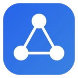
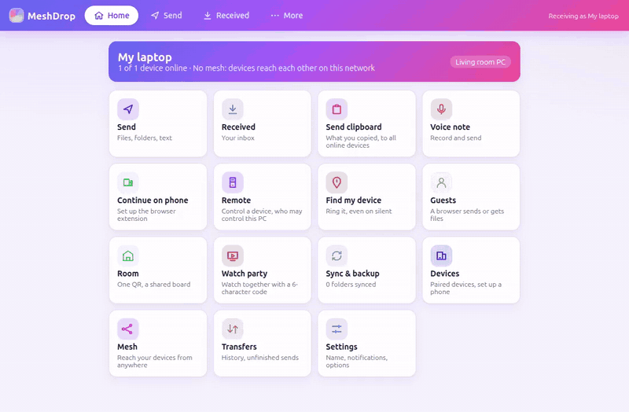
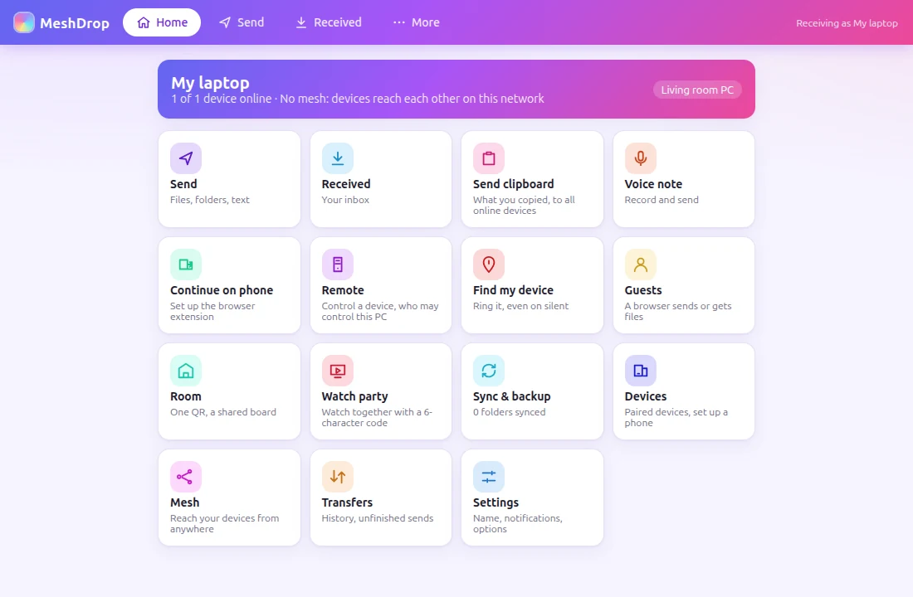
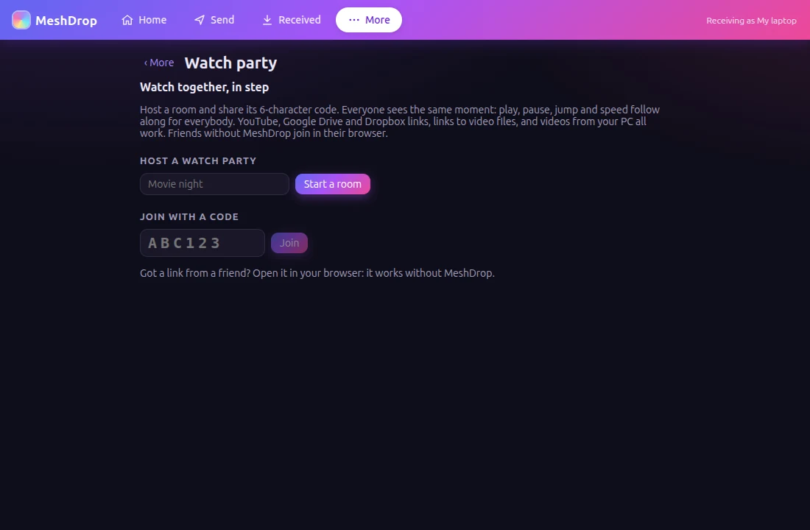
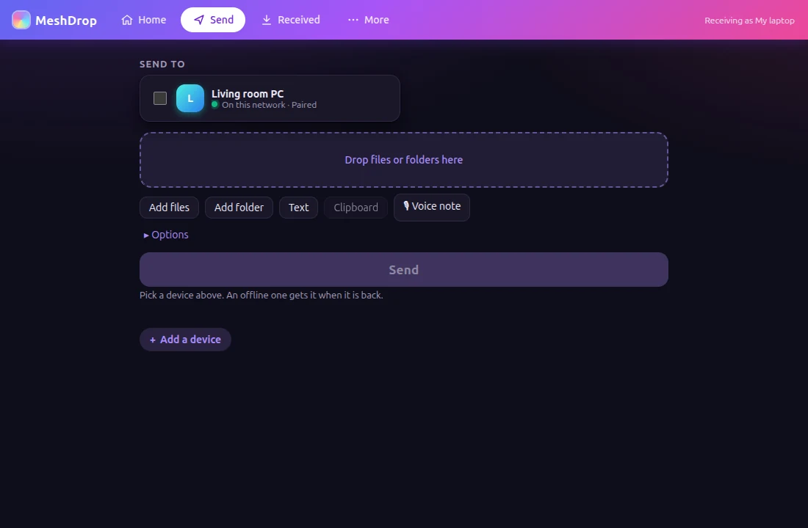
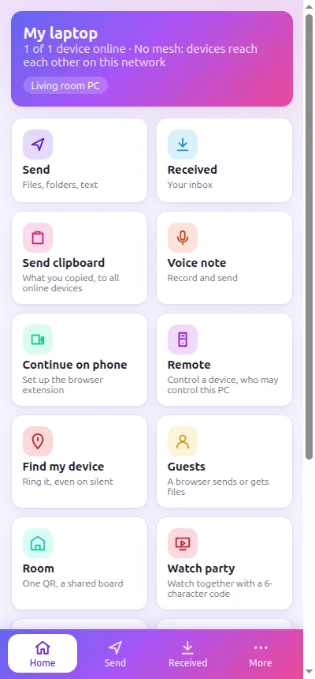
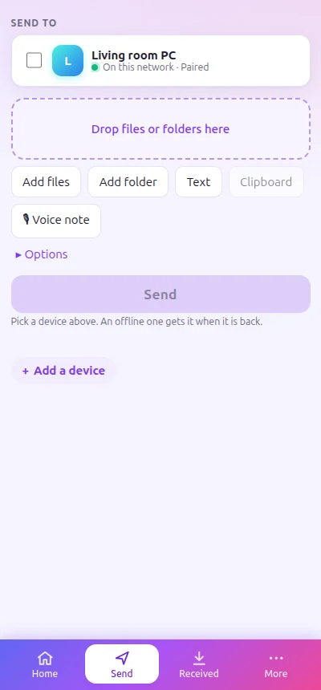
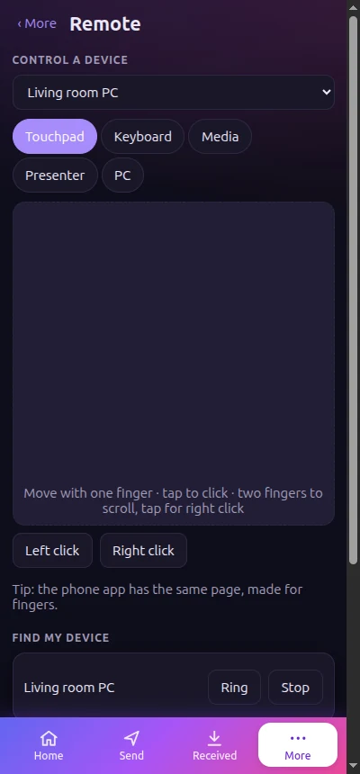
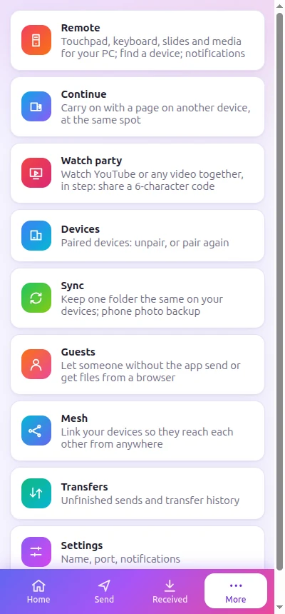

<div align="center">



# MeshDrop

**Your devices, one private mesh.** Send files, text and your clipboard between your Ubuntu PC and Android
phones, control the PC from the phone, watch videos together, and pick up a page on another device where you
left off. End-to-end encrypted, no account, no third-party server.

[](https://github.com/Hafij-DEU/multidevice-sharing/releases/latest)
[](https://github.com/Hafij-DEU/multidevice-sharing/actions/workflows/ci.yml)
[](https://github.com/Hafij-DEU/multidevice-sharing/actions/workflows/codeql.yml)


[**Download for Ubuntu**](https://github.com/Hafij-DEU/multidevice-sharing/releases/latest) ·
[**Download for Windows**](https://github.com/Hafij-DEU/multidevice-sharing/releases/latest) ·
[**Download for Android**](https://github.com/Hafij-DEU/multidevice-sharing/releases/latest) ·
[Features](#features) · [Screenshots](#screenshots) · [Guide](#guide)



<sub>12-second tour ([MP4](docs/media/demo.mp4)): Home → Send → Watch party → Remote → Continue → Settings → light theme.</sub>

</div>

---

## Features

<table>
<tr>
<td width="33%" valign="top">

### 📤 Send anything
Files, whole folders, text and the clipboard to one device or all of them. Big files resume where they
stopped. Drag and drop, the Files right-click menu, Android's Share menu, a keyboard shortcut.

</td>
<td width="33%" valign="top">

### 🔐 Private by design
End-to-end encrypted, with keys only on your devices. On the same Wi-Fi devices talk directly; away from
home they go through a **hub on your own PC**. No cloud, no account.

</td>
<td width="33%" valign="top">

### 🖱️ Phone as remote
Touchpad, keyboard, media keys, a slide **presenter with a laser dot**, lock/sleep the PC. Find a phone
by making it ring, even on silent. Phone notifications show on the PC, and you can reply from there.

</td>
</tr>
<tr>
<td valign="top">

### 🎬 Watch party
Share a **6-character code** and watch YouTube, Google Drive, Dropbox or your own videos **in step**:
play, pause and jumps follow along for everyone. Friends join from any browser.

</td>
<td valign="top">

### 🔁 Continue on another device
Reading in the PC browser? Open the same page on the phone **at the same scroll position**. YouTube
continues at the same second. Works the other way too: Share → *Continue on PC*.

</td>
<td valign="top">

### 🗂️ Sync & photo backup
Keep folders the same on your devices, with conflict copies and a `Deleted` safety net. New phone
photos go to the PC by themselves.

</td>
</tr>
<tr>
<td valign="top">

### 👋 Guests & internet links
Let a friend send or get files from a browser with a QR code, no app needed. Share **encrypted
internet links** with a password, a download limit and an expiry.

</td>
<td valign="top">

### 📷 Phone as webcam & mic
The phone's camera and microphone show up on the PC as normal devices (PipeWire). The PC's sound can
play on the phone.

</td>
<td valign="top">

### ✨ Little extras
Voice notes, burn after reading, read receipts, send later, print on the PC, scan a page to PDF, shake to
grab the PC clipboard, a party drop board, LocalSend compatible, light & dark themes.

</td>
</tr>
</table>

## Screenshots

<table>
<tr>
<td colspan="2" align="center">
<picture>
  <source media="(prefers-color-scheme: dark)" srcset="docs/media/desktop-home-dark.webp">
  
</picture>
<br><sub>Home on the PC: every feature one click away (light or dark follows your GitHub theme)</sub>
</td>
</tr>
<tr>
<td align="center" width="50%"><br><sub>Watch party</sub></td>
<td align="center" width="50%"><br><sub>Send to one or all devices</sub></td>
</tr>
</table>

<table>
<tr>
<td align="center"><picture><source media="(prefers-color-scheme: dark)" srcset="docs/media/phone-home-dark.webp"></picture><br><sub>Home</sub></td>
<td align="center"><br><sub>Send</sub></td>
<td align="center"><br><sub>Remote</sub></td>
<td align="center"><picture><source media="(prefers-color-scheme: dark)" srcset="docs/media/phone-more-dark.webp"></picture><br><sub>Everything else</sub></td>
</tr>
</table>

## Get started

| | |
|---|---|
| **Ubuntu** | Download `meshdrop_<version>_amd64.deb` from [Releases](https://github.com/Hafij-DEU/multidevice-sharing/releases/latest), then `sudo apt install ./meshdrop_*_amd64.deb`. Or install and update it with **App Hub**. |
| **Windows 11** | Download `MeshDrop-Setup-<version>.exe` from [Releases](https://github.com/Hafij-DEU/multidevice-sharing/releases/latest) and run it (it asks for administrator once). It adds MeshDrop to the Start menu, a firewall rule so your phone can reach it, the `meshdrop` command and Explorer's right-click **Send to → MeshDrop**. Sound, camera and microphone streaming are Linux-only for now. |
| **Android 10+** | Download `MeshDrop-<version>.apk` from [Releases](https://github.com/Hafij-DEU/multidevice-sharing/releases/latest) and open it on the phone. |
| **Browser extension** | `meshdrop-extension-<version>.zip` (for *Continue*). App Hub installs it too: MeshDrop card → **Extension**. |

1. **Open MeshDrop** on the PC and the phone. On the same Wi-Fi they appear under *Nearby*.
2. **Pair:** tap the device's card (or *Add by address*). Both screens show the same 6-digit code. Pair only if
   they match.
3. **Send:** tick devices, add files, press **Send**. Files land in `~/Downloads/MeshDrop` on the PC and
   `Download/MeshDrop` on the phone.
4. **Away from home?** Make the PC your hub (More → Mesh → *Create a mesh*, then *Invite a device* and scan the
   QR code on the phone), and give it an internet address. See [Reach your PC from anywhere](#reach-your-pc-from-anywhere).

> [!TIP]
> Settings → **Theme** switches between System, Light and Dark on each device.

## Guide

<details>
<summary><b>🖥️ The PC app</b></summary>

The package installs the app (MeshDrop in the app grid, `/opt/MeshDrop`) and the `meshdrop` command line in
`/usr/bin`.

- Closing the window keeps MeshDrop running in the tray, so it keeps receiving.
- Settings has autostart at login and a GNOME keyboard shortcut (default Ctrl+Alt+C) that sends your
  clipboard. The shared clipboard carries text, copied images and copied files.
- After an update MeshDrop restarts itself as the new version.

</details>

<details>
<summary><b>📱 The Android app</b></summary>

1. Open MeshDrop. It starts a background service with a small notification, so it keeps receiving.
2. Settings → "Keep MeshDrop alive": allow the battery exemption and notifications. On Xiaomi and Tecno
   phones, also follow the Autostart steps.
3. Send from Send (Add files / Add folder / Text), from any app's Share menu, or send the clipboard with the
   notification's "Send clipboard" button or the quick-settings tile.
4. Join the mesh to reach your devices away from home. On the PC, Mesh → "Invite a device" shows a QR code.
   Scan it with the phone's camera: it opens MeshDrop with the invite filled in. Tap Join. Files for a device
   that is off wait on the hub until it comes back.

Some phones (Xiaomi/HyperOS above all) still stop apps in the background. With the phone on USB and USB
debugging on, the PC app lifts every limit at once, without root: More → Devices → **Set up a phone (USB)**.
It does the same as `bash apps/android/scripts/keep-alive-adb.sh`.

</details>

<details>
<summary><b>🖱️ Remote, find my device, notifications</b></summary>

More → Remote, on the phone and on the PC:

- **Control a PC** from the phone: touchpad (tap to click, two fingers to scroll), keyboard, media and volume
  keys, a **presenter** with next/previous slide and a laser dot, and PC actions (lock, sleep, shut down,
  restart, open an app). On the PC, first tick the devices that may control it. The first time, GNOME asks
  once to allow remote interaction (the XDG RemoteDesktop portal, which works on Wayland).
- **Find my device:** Ring makes the phone ring at full volume even on silent (or the PC play an alarm)
  until Stop. Battery, free space and signal of your phones show on the PC.
- **Phone notifications on the PC:** on the phone, tick the PCs to show them on and allow notification
  access once. Messages with a reply action can be answered from the PC.
- **Link handoff:** Send → Text → "Open link on device" opens a link in the other device's browser.
- **PC sound on the phone, phone as webcam and microphone** (same Wi-Fi): the phone's Remote page has
  "Play PC sound here", "Use as webcam" and "Use as microphone". The camera and microphone appear on the
  PC as "<phone> camera (MeshDrop)" and "<phone> microphone (MeshDrop)" (PipeWire, no driver or root).
- **Second screen:** the phone's Remote page opens Extendo.

</details>

<details>
<summary><b>🔁 Continue on another device</b></summary>

- **PC browser → phone:** add the **MeshDrop Handoff** browser extension once (App Hub → MeshDrop →
  *Extension*, or Home → Continue on phone → "Get the extension folder"). Then in `brave://extensions`,
  `chrome://extensions` or `opera://extensions`, turn on Developer mode and *Load unpacked* the
  **MeshDrop Browser Extension** folder in Documents. On the phone, Home → **Continue from PC** opens the page
  your PC browser shows: the same scroll position, and for YouTube the same second. The extension talks only
  to MeshDrop on this PC (127.0.0.1).
- **Phone → PC:** in Chrome, YouTube or any app, Share → **Continue on PC**. A video playing on the phone
  continues at the same second (this needs MeshDrop's notification access).

</details>

<details>
<summary><b>🎬 Watch party</b></summary>

Home → **Watch party**. Start a room and share its **6-character code** (or the link or QR code). Play, pause,
jumps and speed follow along for everybody; one tick lets only the host control playback. There is a chat
and a list of who is watching.

- **What plays:** YouTube links; Google Drive links (shared "anyone with the link"; the room PC relays them);
  Dropbox links; links to video files; your own videos ("Play a video from this PC…" on the PC, "Your video…"
  in the player).
- **Where rooms live:** on your MeshDrop PC, never in an outside cloud. On your Wi-Fi the room works at once;
  friends elsewhere need the hub's internet address. Friends without MeshDrop open the link in any browser.
- A room ends when you press End, or after 6 hours with nobody in it.

</details>

<details>
<summary><b>✨ Extras</b></summary>

- **Voice notes:** Send → Voice note records a message; it goes like a file.
- **Send options:** 🔥 *burn after reading* (the receiver's copy is deleted 5 minutes after it is first
  opened), 🖨 *print on the PC* (`lp`), ⏰ *send later* (sent at its time while the app runs).
- **Read receipts:** your Sent row shows *Opened* when the other device opens it.
- **Smart inbox** (PC Settings): files sorted into Images, Videos, Audio, Documents, Archives or Other;
  optional clean-up after N days.
- **Room mode** (Guests → Room): one QR for everyone on the Wi-Fi; a shared board for photos and files that
  disappears when the room ends.
- **Phone as scanner:** Send → Scan to PDF.
- **Gestures** (phone): flick the file list up to send; shake to grab what is copied on the PC.
- **LocalSend:** LocalSend users on the same Wi-Fi show up as "LocalSend". Both sides ask before anything
  is saved (protocol v2, port 53317).

</details>

<details>
<summary><b>🗂️ Folder sync and photo backup</b></summary>

**More → Sync** keeps folders the same on your devices whenever they are on the same Wi-Fi. Folders match by
name; tick the devices to sync each folder with, on both devices.

- Adds, edits and deletes travel both ways. A file that changed on both sides keeps both versions.
- A file deleted or replaced on another device is kept in the synced folder's `Deleted` folder.
- Sync never goes through the hub, only over the LAN.

**Photo backup** (Android): new camera photos and videos go to the PC by themselves on the same Wi-Fi, into
`~/Pictures/MeshDrop Backup/<phone name>/`.

</details>

<details>
<summary><b>👋 Guests and internet links</b></summary>

**Guests** (same Wi-Fi): Guests → "Show a guest QR code". The friend's browser can send you files and a
message, and download files you offer. Every send asks you first, with names, sizes and thumbnails. The link
works for one browser only, for 1 hour by default. The page is plain HTTP on your network, so use it on
Wi-Fi you trust.

**Internet links:** Guests → Internet links → choose files, how long (1 hour to 30 days), an optional password
and download limit, and whether they may send files back. Files are encrypted on your device. The key is
the part of the link after `#`, which browsers never send to a server, so the hub and any tunnel only see
ciphertext.

</details>

## Reach your PC from anywhere

> [!IMPORTANT]
> Being online is not enough. Your hub PC sits behind your home router, and many providers share one
> public address between many homes (**CGNAT**). Nothing on the internet can open a connection to your PC
> until you give it a way in. Until then, your devices reach each other only on the same Wi-Fi.

On the hub PC: More → Mesh → **Internet access** → *Check my connection*. It tells you whether you are behind
CGNAT and suggests a way in:

| Way in | Needs | Works behind CGNAT |
|---|---|---|
| **Tailscale Funnel** | free Tailscale account; `sudo tailscale up`; allow Funnel for this PC | ✅ |
| **Cloudflare tunnel** | a domain in your Cloudflare account; `cloudflared tunnel login` | ✅ |
| **Port forwarding** | a public IP; a free duckdns.org name (MeshDrop gets a Let's Encrypt certificate and asks the router via UPnP/NAT-PMP) | ❌ |

The address becomes the hub's internet address: your devices use it when they are away, and watch parties and
internet links point at it. From a terminal: `meshdrop hub reach detect | tailscale | cloudflare HOST |
port-forward NAME --token-file F [--manual] | off`.

<details>
<summary><b>A hub that is always on (relay hubs)</b></summary>

When the hub PC is off, a **relay hub** keeps sends, waiting files and internet links going. It is one of
your mesh devices that is always on (a cheap VPS or a second PC) at a public `wss://` address.

1. On that machine: `meshdrop join <invite>`, then run `meshdrop listen` as a service, with a TLS proxy or
   tunnel in front of its loopback port 53319 (for example Caddy: `reverse_proxy 127.0.0.1:53319`).
2. On the hub PC: Mesh → Relay hubs → enter `wss://relay.example.com/mesh/v1/hub` → Save.

Devices move to the relay while the hub PC is away, and back within 5 minutes after it returns. A relay
never holds the mesh key.

</details>

## Command line

```text
meshdrop id                         this device's id
meshdrop listen                     receive until Ctrl-C (or run it as a service)
meshdrop pair <host[:port]> <name>  trust a device by address (both sides)
meshdrop send <device|all> <path…>  send files or folders (--text "..." for text)
meshdrop outbox / resume            unfinished sends
meshdrop guest                      a guest QR link for a browser on this network
meshdrop link create|list|revoke    encrypted internet links
meshdrop hub init / invite / join / members / hub revoke / hub relays / hub reach / hub recovery-export
```

Every command takes `--home DIR` to use another config folder. `meshdrop --help` lists all options.

## Development

Node 24, pnpm 10, the Android SDK in `~/Android/Sdk` and Gradle 8.11.1.

```bash
pnpm install
pnpm test                                    # core + desktop unit tests
pnpm typecheck
pnpm desktop:e2e                             # Playwright tests of the Electron app
pnpm desktop:dev                             # build and start the app
bash apps/desktop/scripts/build-deb.sh       # the .deb in apps/desktop/dist-deb
bash apps/android/scripts/release.sh         # the signed APK in apps/android/dist-apk
bash apps/desktop/scripts/build-extension-zip.sh   # the browser extension .zip in dist/
cd apps/android && ~/.local/opt/gradle-8.11.1/bin/gradle --offline :engine:test   # Java engine + Node interop
```

The wire protocol is in [docs/protocol.md](docs/protocol.md). The APK signing key is created once in
`~/.android`; keep it, because every update must be signed with it.

<div align="center"><sub>GPL-3.0-only · made by Hafij-BGE</sub></div>
